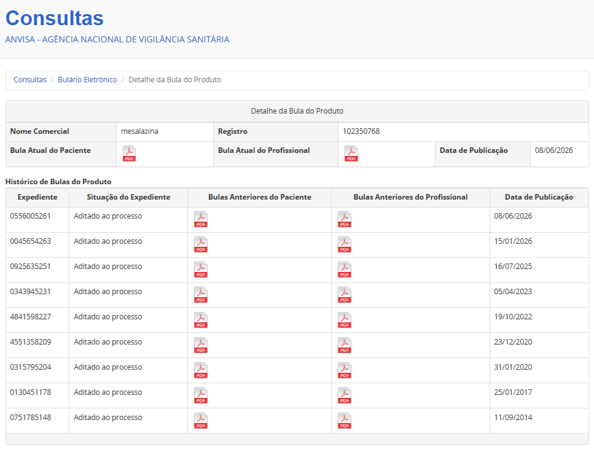

# Memória técnica do Apêndice A

Luiz Gustavo de Carvalho Pena · Versão 1.1.2 · 22 de novembro de 2026.

As seções M01–M07 documentam a investigação da demanda do CEAF em Minas Gerais entre 2014 e 2025. As tabelas de resultados usam preços médios de 2025. O [manifesto](manifesto.json) identifica o arquivo analisado. O [dicionário](dicionario_de_arquivos.csv) indica a localização das bases externas.

## M01 — Construção da base e conciliação cadastral

A unidade de observação é o item de compra, identificado por um ID. As planilhas administrativas da DPAM/SES-MG fornecem o universo de processos; a combinação entre unidade de compra, número sequencial e ano permite recuperar os relatórios do SIAD. A base conciliada reúne 9.585 itens, 4.741 processos e 178 fármacos. A conferência de repetições considera o item, as quantidades, os valores e a situação da aquisição, preservando pedidos distintos. A última conferência recuperou o CNPJ completo do favorecido em 228 itens, dos quais 97 foram vinculados a estabelecimentos mineiros. A aba Conciliacao_CNPJ_21nov da planilha suplementar registra o fundamento de cada correção.

Os sete primeiros dígitos do processo identificam a unidade de compra. As unidades 1321075, 1321129 e 1501559 correspondem, respectivamente, a 4.421 itens programáticos, 4.677 judiciais e 436 programáticos. A unidade 1501559 estava vinculada ao Centro de Serviços Compartilhados da Seplag e conduziu processos de aquisição para a SES-MG. Outros 51 itens pertencem ao canal programático, com inclusão documentada nos campos Motivo_inclusao e Lastro_documental. A soma é de 4.908 itens programáticos e 4.677 judiciais.

A conciliação cadastral do fornecedor Biohosp recuperou o CNPJ de 13 itens e retirou oito duplicatas. A decisão sobre chaves coincidentes considera a descrição do item, a quantidade, o valor, o fornecedor e a situação no SIAD. O cenário S01 conserva o valor P1+P2 e simula a retenção de uma ocorrência por grupo em 65 grupos de 162 registros. O denominador perde 97 linhas e R$ 3,69 milhões. A participação em valor passa de 0,3702% para 0,3706%.

## M02 — Cobertura e referência temporal

Dos 9.585 itens, 8.876 possuem valor homologado recuperado e 709 permanecem nas contagens com valor ausente. A Tabela A.1 discrimina a cobertura por ano e canal.

Os valores associados aos itens homologados somam R$ 2.989.288.649,07 nominais e R$ 3.907.007.679,55 a preços médios de 2025. A atualização aplica o fator anual da aba IPCA conforme Ano_referencia; os agregados somam valores não arredondados e preservam as ausências.

Ano_referencia organiza a série por exercício informado pela fonte. Na base original, 57 registros acompanham a homologação de processos do exercício anterior. No complemento, 237 referências diferem do ano do processo. Ano_homologacao apresenta 1.077 ausências e 21 divergências entre os anos preenchidos. A série fiscal utiliza o exercício de emissão do empenho.

O Quadro A.2 informa as datas de consulta. Para a classificação industrial, a data de acesso em 2026 identifica a coleta. O histórico sanitário documenta as apresentações e as decisões de registro e pós-registro ao longo do período. O procedimento para relacionar uma compra à rota consta de M05.

## M03 — Execução financeira e referência fiscal

Execução financeira. A vinculação entre processo e empenho alcança 4.371 dos 4.741 processos (92,20%) e abrange 9.081 itens. Os outros 370 processos, com 504 itens, permanecem sem execução observada. Empenhos, liquidações e pagamentos vinculados ao processo foram rateados entre os itens proporcionalmente aos respectivos valores homologados; itens sem valor recuperado não recebem rateio. Após a exclusão das parcelas dos oito registros duplicados, os montantes nominais atribuíveis somam R$ 3.054.790.833,96 em empenhos, R$ 2.334.053.126,47 em liquidações e R$ 1.888.579.305,99 em pagamentos. A conciliação considera processo, ano e número do empenho. A reprodução integral requer os arquivos brutos, os denominadores e a memória fiscal indicados no Quadro A.1.

Cobertura dos agregados. Do total homologado nominal, R$ 180.990.012,17 referem-se a 395 itens sem ponte oficial de execução. Nos 8.481 itens com valores de homologação e empenho recuperados, os montantes são R$ 2.808.298.636,90 e R$ 3.054.790.833,96, respectivamente: diferença de R$ 246.492.197,06 (8,78%). Descontado o homologado sem ponte, obtém-se a diferença de R$ 65.502.184,89 entre os totais gerais. Essa conciliação aritmética não identifica as causas contratuais ou temporais do descompasso; a falta de ponte permanece distinta da ausência de execução.

Conferência da diferença. A agregação dos valores nominais por Processo_SIAD identifica R$ 137,76 milhões de diferença positiva entre empenho e homologação nos dez processos com maiores diferenças positivas. Todos os itens desses processos possuem valor homologado recuperado. A reorganização dos empenhos atribuíveis pelo Ano_referencia das compras, com atualização pelo IPCA desse ano, resulta em queda de 27,44% entre as médias de 2014–2018 e 2019–2025, próxima dos 27,46% da série fiscal. As memórias dos recortes da centralização e dos empenhos por item documentam, por ID, o ano, o fármaco, o empenho atribuído, o fator IPCA e as fórmulas dos recortes de oito e sete fármacos. Essa memória reproduz a aproximação por ano de referência; a reconstrução fiscal por medicamento exige os denominadores originais do rateio e os registros individualizados de empenhos e anulações.

Referência fiscal. Os denominadores provêm da DCA/Siconfi, Anexo I-E, para Minas Gerais (ente 31), coluna Despesas Empenhadas, contas 10 - Saúde e 10.303 - Suporte Profilático e Terapêutico, exceto intraorçamentárias. As séries são atualizadas pelo mesmo fator anual do IPCA; as razões acumuladas dividem as respectivas somas em preços de 2025. A série fiscal oficial foi preservada. A exclusão de R$ 614.154,76 atribuídos aos oito registros duplicados eleva o resíduo nominal entre essa série e os itens de R$ 0,04 para R$ 614.154,80, sem redistribuição automática das parcelas. A rubrica 10.303 constitui referência de escala, pois a base não informa a classificação funcional de cada empenho do CEAF.

Testes de robustez e análises complementares. O contraste fiscal 2014–2019/2020–2025 preserva a redução real do CEAF (−19,30%) diante do crescimento da Função 10 (+15,17%); a razão CEAF/Função 10 diminui 29,93%. Na decomposição por ano de referência, os fármacos com empenho atribuído observado nos dois períodos contribuem com −R$ 151,3 milhões anuais; aqueles com valor observado apenas no primeiro, com −R$ 25,3 milhões; e apenas no segundo, com +R$ 64,8 milhões. A comparação exploratória reúne 23 UFs com série completa, e a conferência administrativa parte de 881 registros, dos quais 791 integrados à base conciliada.

Procedimento da decomposição. A memória de decomposição dos empenhos atribuídos agrupa os 178 fármacos pela presença de empenho atribuído observado: 124 nos dois períodos, 21 apenas em 2014–2018, 29 apenas em 2019–2025 e quatro sem valor observado. Levetiracetam e cinacalcete têm compras nos dois períodos, mas empenho recuperado somente no segundo. As médias dividem por cinco e sete anos as somas atualizadas pelo fator do Ano_referencia. A redução de R$ 111.849.051,33 é R$ 103.732,88 inferior aos R$ 111.952.784,20 da série por exercício fiscal; a diferença entre agregações não decorre apenas do arredondamento. A memória dos recortes da centralização reproduz os recortes de deferasirox, alfadornase, entacapona, galantamina, sildenafila, desmopressina, quetiapina e metotrexato, com teste que exclui integralmente a quetiapina, cuja centralização alcançou somente 300 mg. Esses cálculos descrevem variações observadas e não estimam o efeito causal da centralização.

Na aproximação por ano de referência das compras, os empenhos atribuídos aos oito fármacos abrangidos pela centralização apresentaram redução de R$ 50,3 milhões na média anual entre 2014–2018 e 2019–2025, equivalente a 44,9% da queda da série fiscal do CEAF. Como a centralização da quetiapina alcançou apenas a apresentação de 300 mg, o cálculo foi repetido sem esse fármaco: R$ 43,7 milhões anuais e 39,0% da queda fiscal. Os resultados mostram que parte da retração se concentrou em fármacos sujeitos à centralização, sem estimar quanto dessa redução decorreu diretamente da transferência das compras para a União. A memória do cálculo consta do Apêndice A.

Nos seis itens com desistência documentada, foram conferidos a situação e a data de homologação ou ratificação e os valores das respectivas propostas vencedoras. Esses registros permanecem na série histórica, com a desistência identificada nas abas Itens_desistentes e Concilia_4_processos da planilha suplementar. O total atual do processo e a execução individual são informações distintas. A aba Sensibilidade_desistencias apresenta a hipótese de retirada dos casos conhecidos; a busca documental não foi exaustiva.

## M04 — Carteira e responsabilidade administrativa

O enquadramento é reconstruído por apresentação e exercício. Nos Gráficos 4.1, 4.5 e 4.6, utiliza-se o campo Grupo_declarado_no_ano. Quando há informação no campo Grupo histórico proposto da aba Camada_881, esse enquadramento é aplicado ao respectivo ID. As ações orçamentárias variam por exercício e ciclo do PPAG (Quadro A.3), e a unidade de compra também permite distinguir os canais.

A seleção da carteira combina compras em pelo menos oito dos doze anos, valor acumulado igual ou superior a R$ 10 milhões e histórico de financiamento e aquisição estaduais. Os dois primeiros filtros identificam 43 fármacos; 16 também atendem ao terceiro, conforme a Tabela A.2. O aprofundamento considera suas compras programáticas, que somam R$ 1.324.441.753,38, equivalentes a 33,90% do universo. A responsabilidade administrativa de cada aquisição permanece definida no nível item-ano.

Na carteira, 77 itens programáticos, com R$ 182,9 milhões, permanecem com responsabilidade por exercício indeterminada. Sua inclusão no universo se apoia em evidências de pertencimento ao CEAF; o histórico estadual do fármaco orienta a seleção da carteira. O efeito da retirada desses registros é apresentado no Quadro A.4.

A glargina conta com protocolo estadual desde 2010 (Resolução SES-MG nº 2.359/2010), mas figura como responsabilidade estadual nos elencos anuais consultados a partir de 2021. Nos inalatórios, essa declaração consta dos documentos de 2018–2025; o enquadramento de 2017 foi imputado a partir de documento de outro exercício, e o de 2016 não é declarado. A base registra a imputação de 2017, mas não individualiza o documento utilizado. Essas marcações expressam limites de cobertura documental, e não o início da responsabilidade estadual.

A Tabela A.3 apresenta um recorte complementar: fármacos com Origem = IMPORTADO em todos os registros agrupados por Farmaco_analitico. Contam-se os anos distintos de Ano_referencia e somam-se os valores homologados observados a preços de 2025; os percentuais utilizam o total de R$ 3.907.007.679,55. Os nove recorrentes, presentes em pelo menos oito anos, integram o total de 41 fármacos. O recorte descreve a origem dos produtos adquiridos.

Na carteira programática, o campo Carteira (1/0) da aba Ajuste temporal identifica os 40 itens P1+P2 da Tabela 7.3. São 19 de atorvastatina (P1), dois de insulina glargina, onze de gabapentina e oito de topiramato (P2). Juntos, somam R$ 9.747.301,03 dos R$ 1.324.441.753,38 homologados na carteira (0,736%).

No cenário S11, o filtro de responsabilidade administrativa retira 77 registros programáticos do denominador. O valor dos 40 itens P1+P2 soma R$ 9.747.301,03, agora sobre R$ 1.141.585.782,87 (0,8538%). A composição por fármaco está em [carteira_p1_p2.csv](carteira_p1_p2.csv).

## M05 — Identificação sanitária e correspondência industrial

A identificação sanitária parte da especificação do item, da proposta vencedora, do fornecedor, do CNPJ, da ata, da marca e do modelo. Os identificadores extraídos dos relatórios do SIAD são conferidos nos documentos de origem. RMS_produto_9 identifica o produto, e RMS_apresentacao_13, a apresentação; Como_o_RMS_foi_obtido e Nivel_da_evidencia registram a procedência do vínculo. Registros herdados ou inferidos de outra aquisição com o mesmo CATMAS permanecem distinguidos dos documentos específicos da apresentação.

Para cada item, confrontaram-se o produto e a apresentação identificados no SIAD com o registro, os dizeres legais das bulas e as petições de pós-registro da Anvisa. Os documentos vinculam uma etapa, como fabricação integral, formulação, envase ou embalagem, a um estabelecimento. O histórico permite comparar a autorização dessa etapa com o ano da compra. Quando a autorização é posterior, a cronologia é indicada expressamente. A identificação da planta que executou uma entrega específica depende da rastreabilidade do lote.

O campo Classificacao_P_final distribui os 9.585 itens entre P1 (105), P2 (184), P3 (52), P4 (8.512) e P5 (732). A Tabela 7.1 reúne em P1+P2 os 289 itens com fabricação integral ou parcial documentada em Minas Gerais nos registros sanitários da Anvisa. Eles somam R$ 14.465.028,55, ou 0,3702% do valor homologado a preços de 2025. P3 identifica a fabricação exclusiva do diluente. Em P2, a classificação conserva as operações descritas na fonte, inclusive a distinção entre granel e embalagem a granel.

Na carteira programática, o campo Carteira (1/0) da aba Ajuste temporal identifica os 40 itens P1+P2 da Tabela 7.3. São 19 de atorvastatina (P1), dois de insulina glargina, onze de gabapentina e oito de topiramato (P2). Juntos, somam R$ 9.747.301,03 dos R$ 1.324.441.753,38 homologados na carteira (0,736%).

A cobertura sanitária distingue identificação e conclusão da rota. Há 7.820 itens com RMS de 13 dígitos preenchido, dos quais 7.397 com evidência no nível da apresentação. Entre os 1.765 sem esse código, 924 possuem o RMS do produto e 841 não têm nenhum dos dois identificadores. Seis dos 732 itens P5 possuem RMS de apresentação, mas a documentação disponível não permite concluir a rota. As contagens por categoria e o histórico das reclassificações permanecem na memória técnica.

A origem do produto acabado e a correspondência industrial são classificações complementares. O recorte exclusivamente nacional soma R$ 631,05 milhões, dos quais R$ 8,23 milhões em P1+P2 (1,30%). Incluídas as apresentações multiplanta, o denominador passa a R$ 1.192,13 milhões: P1+P2 representa 1,21%, P3, 4,66%, e P4, 94,12%. Os quatro registros P5 desse recorte não têm valor observado. A base identifica plantas mineiras, mas não reúne a UF de todas as plantas nacionais.

A classe P5 expressa o resultado final do cruzamento dos 732 itens cuja compra não permite determinar a localização industrial com a precisão exigida. O cenário S08 simula sua atribuição integral ao numerador. Os 333 itens do S09 pertencem a P4 na base final. A aba Recorte_P4_S09 identifica esse conjunto. A aba Registros_triagem_Anvisa documenta o resultado do cotejo de 75 registros, dos quais 29 aparecem em compras com classe P4 e 46 ficaram sem aquisição diretamente vinculada pelo registro consultado.

### Apresentações, etapas e cronologia

Nas Figuras A.1 e A.2, o item de atorvastatina de 20 mg é vinculado ao RMS 1438102740141, com processo produtivo completo documentado em Pouso Alegre (P1). As bulas de 2016 e 2021 já indicavam a fabricação local antes das compras programáticas dos respectivos registros (Cimed, 2016, 2021). A Seção 8.1 distingue a planta da Cimed dos estabelecimentos favorecidos nos 31 itens dos dois canais.

Para a gabapentina da Biolab, a conferência nos registros sanitários da Anvisa confirmou P2 nos 17 itens adquiridos, dos quais onze são programáticos. Dez itens correspondem ao Empak de 300 mg ou 400 mg, ambos com 30 cápsulas (RMS 1097402820035 e 1097402820043), e sete ao genérico de 400 mg com 30 cápsulas (RMS 1097402910042). As três apresentações têm processo produtivo completo registrado em Jandira (SP) e embalagem primária e secundária em Pouso Alegre (MG). A documentação de 2023 refere-se ao genérico de 400 mg (Anvisa, 2026a).

No caso da Biomm, os três itens de glargina vencidos em 2024 corresponderam a 2,45% do valor homologado para o fármaco nos dois canais. A bula profissional do Glargilin, vinculada ao RMS de produto 133480001, documentava, desde 13 de março de 2020, a inclusão da unidade de Nova Lima para embalagem secundária do refil carpule, em rota com medicamento fabricado pela Gan & Lee, na China (Biomm, 2026b). A aprovação pós-registro para formulação e envase em Nova Lima foi publicada em 2 de abril de 2024 (Anvisa, 2024), após a homologação do principal item, em 14 de março de 2024 (R$ 4,15 milhões, ou 79,7% do valor contratado com a empresa).

Nos três itens de glargina, o histórico da Anvisa e a bula fundamentam P2 pela embalagem secundária do refil já autorizada na data das compras. Os registros do SIAD identificam o produto pelo RMS de nove dígitos. A formulação e o envase integram a rota autorizada em Nova Lima a partir de abril de 2024. A identificação do estabelecimento responsável por cada entrega é feita por lote. O Quadro A.4 reúne os testes de sensibilidade.

O histórico sanitário da Anvisa identifica os estabelecimentos e as etapas autorizadas para as apresentações. A aba Ajuste temporal da base conciliada relaciona os 289 itens P1+P2 da Tabela 7.1 e a documentação de suas rotas. A aba Vigencia_10nov da planilha suplementar conserva a trilha de classificação, inclusive os cinco itens que passaram a P5 em 16 de novembro. Na Eurofarma, os 37 itens P2 de topiramato (29), budesonida (seis) e enoxaparina (dois) antecederam a abertura da unidade de embalagem de Montes Claros em outubro de 2025 (Eurofarma, 2025). Oito dos 29 itens de topiramato integram a carteira programática (Quadro 7.1).

Para o ciprofibrato da Biolab, 39 itens P2 têm etapa de embalagem autorizada em Pouso Alegre. A planilha suplementar identifica os registros sanitários correspondentes. Os 52 itens de gabapentina e ciprofibrato anteriores a 2025 formam o recorte contrafactual S04. A sua retirada apenas do numerador reduz P1+P2 para R$ 12.296.766,64 (0,3147%). A medida principal segue a classificação das rotas documentadas na Anvisa.

Para reproduzir a Seção 7.4, a planilha de explicações alternativas confronta as apresentações dos dez fármacos com rota nacional e sem etapa mineira nas compras com os locais registrados na Anvisa e as linhas certificadas nos CBPF. As abas Resultado e Locais_verificados detalham os casos. Dos R$ 542,69 milhões do recorte, R$ 69,15 milhões correspondem a formas gerais compatíveis sem fabricação mineira da molécula, R$ 406,64 milhões a formas gerais cuja adequação a requisitos específicos exige avaliação técnica, e R$ 66,89 milhões a formas ou dispositivos sem correspondência direta nos certificados. As parcelas foram arredondadas separadamente.

### Leitura retrospectiva do Bulário Eletrônico

O Bulário Eletrônico organiza as versões pelo número do registro e pela data de publicação. A consulta realizada em novembro de 2026 para a mesalazina (registro 102350768) recuperou nove expedientes. A relação abaixo conserva a ordem cronológica.

| Publicação | Expediente |
| --- | --- |
| 11/09/2014 | 0751785148 |
| 25/01/2017 | 0130451170 |
| 31/01/2020 | 0315795204 |
| 23/12/2020 | 4551358209 |
| 19/10/2022 | 4841598227 |
| 05/04/2023 | 0343945231 |
| 16/07/2025 | 0925635251 |
| 15/01/2026 | 0045654263 |
| 08/06/2026 | 0556005261 |

Figura A.3. Fonte: Anvisa, Bulário Eletrônico, registro 102350768. Consulta em novembro de 2026.

As nove datas correspondem a publicações em sete anos. Para uma aquisição em ano intermediário, localiza-se a versão aplicável à data e lê-se, nos dizeres legais, a descrição de quem fabrica, importa ou embala a apresentação. Atos de pós-registro permitem datar alterações entre versões. A sequência de datas documenta a disponibilidade retrospectiva das bulas. A atribuição de uma rota exige a leitura do conteúdo de cada documento aplicável.

[Bulário Eletrônico da Anvisa](https://consultas.anvisa.gov.br/#/bulario/) · [Consulta de medicamentos da Anvisa](https://consultas.anvisa.gov.br/#/medicamentos/) · [Datas e expedientes em CSV](historico_bulas_mesalazina.csv)

### Sensibilidade da correspondência

A Tabela A.4 detalha o cenário S02. A exclusão alcança 400 registros com RMS herdado e 109 com origem inferida. Os 13 itens P1+P2 retirados não possuem valor homologado observado.

Os testes industriais do Quadro A.4 partem dos 289 itens P1+P2 da Tabela 7.1. No cenário S04, a retirada hipotética dos 52 itens da Biolab anteriores a 2025 altera apenas o numerador. A classificação P2 dessas compras está documentada na Anvisa. O cenário S05 preserva um cálculo anterior à conciliação de 16 de novembro. Os cenários podem se sobrepor e devem ser lidos separadamente. Nos testes fiscais S12 e S13, a referência é a execução da despesa. Na comparação entre 2014–2019 e 2020–2025, os indicadores da Tabela 4.1 conservam sua direção, e a razão CEAF/Subfunção 303, não exibida naquela tabela, cresce 1,89%.

Os cenários S01–S13 reproduzem as regras e os valores do Quadro A.4. S03, por exemplo, restringe as compras aos 7.397 itens com evidência no nível da apresentação e identifica 258 em P1+P2. S04 conserva todo o denominador e altera apenas o numerador. As definições de cada recorte estão em [testes_sensibilidade.csv](testes_sensibilidade.csv).

## M06 — Emprego e ocupações

Recortes da RAIS/eSocial. Foram contados os vínculos ativos em 31 de dezembro por ano, UF, município do estabelecimento e CNAE. O segmento produtivo reúne 2110-6/00, 2121-1/01, 2121-1/02, 2121-1/03 e 2123-8/00; o distributivo, 4644-3/01 e 4645-1/01. As comparações ocupacionais concentram-se nos medicamentos humanos e no atacado 4644-3/01. O índice de emprego adota 2014 = 100; o QL farmacêutico considera medicamentos humanos e preparações, e o farmoquímico, 2110-6/00. As somas municipais por CNAE coincidiram com os totais estaduais; a referência nacional e as comparações entre MG, SP, RJ e GO utilizam os mesmos recortes. Na sensibilidade de Guaxupé, o filtro exclui os vínculos da CNAE 2110-6/00 no município de código IBGE 3128709: 144 − 64 = 80 vínculos em 2025. O arquivo municipal utilizado não contém CNPJ empregador; o teste exclui o recorte territorial, sem atribuir seus vínculos a um estabelecimento.

Classificação ocupacional. As famílias CBO foram identificadas por quatro dígitos e agrupadas pelo primeiro: 2, profissionais das ciências e artes; 3, técnicos de nível médio; 4, serviços administrativos; 7, trabalhadores da produção industrial; e 8, operadores de máquinas e processos. Os demais códigos e as ausências foram classificados como outros. As somas por família conferem os totais de cada segmento.

## M07 — Extração e tratamento documental

Nas rotinas de extração dos relatórios do SIAD, a biblioteca pdfplumber e expressões regulares foram utilizadas para localizar os campos de interesse nos arquivos PDF. O processamento desconsiderou cabeçalhos e rodapés repetidos, recompôs informações de itens distribuídas entre páginas e distinguiu registros homologados, desertos, fracassados e revogados. No rastreamento sanitário, expressões regulares auxiliaram o reconhecimento e a padronização do RMS nos campos textuais e a localização dos blocos de fabricação, registro, importação e embalagem nas bulas. As informações extraídas foram confrontadas com os documentos de origem.
